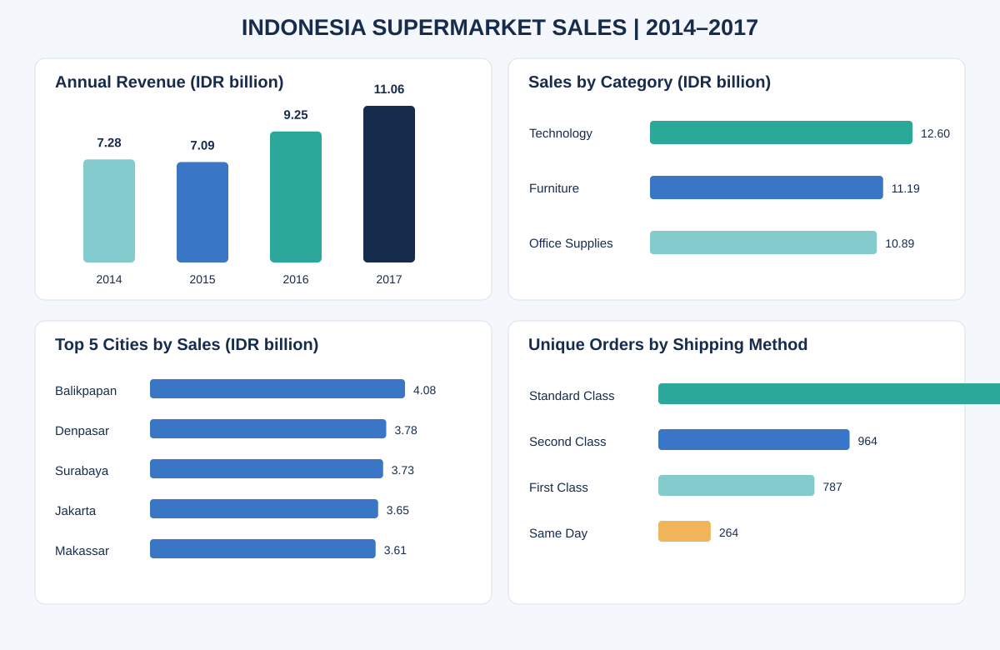
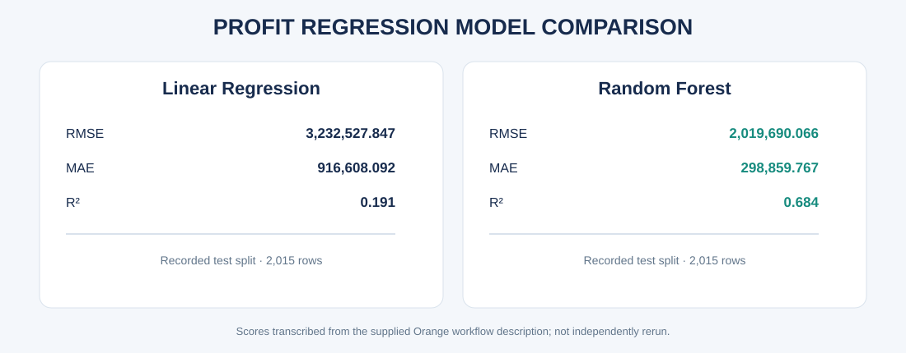

# 🛒 Supermarket Sales Analysis — Indonesia

**Analisis performa penjualan supermarket berbasis synthetic dataset periode 2014–2017, mulai dari data preparation dan exploratory analysis hingga business intelligence serta profit prediction.**

  
  
  
  

---

## 📌 About This Project

Repository ini mendokumentasikan analisis penjualan supermarket di Indonesia untuk periode pemesanan **2014–2017**. Project berfokus pada pemeriksaan kualitas data, data cleaning, exploratory data analysis (EDA), business intelligence, dan pemodelan regresi untuk mengestimasi keuntungan pada level baris transaksi.

Dataset yang digunakan merupakan **synthetic dataset**, bukan catatan operasional supermarket atau transaksi pelanggan nyata. Karena itu, seluruh temuan diposisikan sebagai hasil latihan analisis dan pemodelan pada data simulasi, bukan sebagai representasi kondisi pasar Indonesia.

## 🎯 Project Objectives

1. Memahami struktur dataset dan memeriksa data quality sebelum analisis.
2. Menyiapkan field tanggal pengiriman, kota, dan kode pos dengan tetap mempertahankan kolom sumber.
3. Mengeksplorasi penjualan berdasarkan tahun, kategori produk, kota, wilayah, dan metode pengiriman.
4. Mengidentifikasi pola akumulasi penjualan berdasarkan kalender bulan.
5. Membandingkan Linear Regression dan Random Forest untuk estimasi keuntungan per baris transaksi.
6. Mendokumentasikan analytical findings melalui visualisasi dan dashboard.

## 🗂️ Dataset Overview

| Item | Detail |
|---|---:|
| Source worksheet | `sources` |
| Order period | 3 January 2014 – 30 December 2017 |
| Transaction lines | 10,076 |
| Source columns | 21 original + 3 prepared fields |
| Unique orders | 5,009 |
| Unique customers | 793 |
| Unique product IDs | 1,862 |
| Total sales | **Rp34,679,574,266** |
| Total quantity | **38,179 units** |
| Recorded profit | Rp4,310,163,913 |

Dataset workbook juga memuat reference tables, pivot analysis, basic analysis questions, query summaries, dan top-product summary. Tautan workbook dan dashboard tersedia pada bagian [Interactive Dashboard & Supporting Materials](#-interactive-dashboard--supporting-materials).

## 🧹 Data Quality Overview

Pemeriksaan dilakukan pada worksheet `sources` yang berisi 10,076 rows dan 24 columns. Kolom asli dipertahankan, sedangkan hasil preparation disimpan pada field terpisah.

| Quality check | Source | Prepared result |
|---|---:|---:|
| Missing shipping dates | 315 | 0 pada `clean_tanggal_pengiriman` |
| Missing city values | 314 | 0 pada `clean_kota` |
| Missing postal codes | 315 | 0 pada `clean_kode_pos` |
| Zero sales values | 0 | Tidak ditemukan |
| Negative profit values | 1,885 | Dipertahankan sebagai loss observations |
| Zero profit values | 65 | Dipertahankan |
| Exact duplicate rows | 0 | Tidak ditemukan |
| Distinct `row_id` | 9,994 | Bukan unique key |

**Catatan data preparation:** tanggal pengiriman yang kosong diisi menggunakan tanggal pemesanan. Ini merupakan asumsi untuk melengkapi working table, bukan tanggal pengiriman aktual yang terverifikasi. Karena itu, field hasil imputasi tidak digunakan untuk menyimpulkan kecepatan pengiriman. Detail pemeriksaan tersedia di [Data Quality Notes](docs/data-quality.md).

## 🔎 Analysis Workflow

1. **Data inspection** — memahami struktur, tipe data, rentang tanggal, dan missing values.
2. **Data preparation** — melengkapi field tanggal, kota, dan kode pos melalui reference mapping; kolom sumber tetap disimpan.
3. **Exploratory analysis** — menghitung sales, quantity, unique orders, dan distribusi berdasarkan dimensi bisnis.
4. **Business intelligence** — menyajikan annual revenue, category contribution, city performance, shipping method, dan calendar-month aggregation.
5. **Predictive modeling** — membandingkan dua regression models untuk estimasi profit pada transaction-line level.

## 📊 Key Findings

### 1. Annual sales performance

| Order year | Sales | Year-over-year change |
|---|---:|---:|
| 2014 | Rp7,281,039,467 | — |
| 2015 | Rp7,094,563,941 | -2.56% |
| 2016 | Rp9,246,372,270 | +30.33% |
| 2017 | Rp11,057,598,588 | +19.59% |

Penjualan sempat turun pada 2015, kemudian meningkat pada 2016 dan 2017. **Tahun 2017 mencatat penjualan tertinggi** selama periode analisis.

### 2. Sales contribution by category

| Category | Sales | Share |
|---|---:|---:|
| Technology | Rp12,601,318,755 | 36.34% |
| Furniture | Rp11,191,576,106 | 32.27% |
| Office Supplies | Rp10,886,679,405 | 31.39% |

Technology menjadi kategori dengan kontribusi penjualan terbesar.

### 3. City performance

Balikpapan mencatat penjualan tertinggi sebesar **Rp4,077,279,974** (11.76% dari total penjualan), diikuti Denpasar dan Surabaya.

### 4. Unique orders by region

| Region | Unique orders | Share |
|---|---:|---:|
| Central | 1,933 | 38.59% |
| South | 1,063 | 21.22% |
| East | 1,037 | 20.70% |
| West | 976 | 19.48% |

Central memiliki jumlah unique orders terbesar dalam dataset.

### 5. Shipping method

| Shipping method | Unique orders | Share |
|---|---:|---:|
| Standard Class | 2,994 | 59.77% |
| Second Class | 964 | 19.25% |
| First Class | 787 | 15.71% |
| Same Day | 264 | 5.27% |

Standard Class merupakan metode pengiriman yang paling banyak digunakan berdasarkan jumlah pesanan unik.

### 6. Cumulative sales by calendar month

Akumulasi penjualan untuk bulan kalender yang sama selama 2014–2017 tertinggi pada **November (Rp5,300,080,126)**, diikuti Desember (Rp4,923,196,267) dan September (Rp4,675,046,380). Angka ini merupakan agregasi lintas tahun, bukan monthly forecast.

## 📈 Data Visualization

### Sales overview

### Profit model comparison

Visualisasi ringkas di atas disusun dari agregasi worksheet sumber dan metrik yang tercatat dalam workflow Orange. Laporan visual dua halaman dari project juga disiapkan sebagai supporting material.

## 🔗 Interactive Dashboard & Supporting Materials

- [Looker Studio — Supermarket Sales Dashboard](https://datastudio.google.com/reporting/85d25820-7889-47b3-9181-f0b648ab0a11)
- [Google Sheets — Dataset & Analysis Workbook](https://docs.google.com/spreadsheets/d/10lisgzLeKctiXgy_6snTHfIs6_QuAsASzLCqs5beRBs/edit?usp=sharing)
- [Data Dictionary](docs/data-dictionary.md)
- [Data Quality Notes](docs/data-quality.md)
- [Model Evaluation Notes](docs/model-evaluation.md)

## 🤖 Predictive Analysis — Profit Estimation

Pemodelan bertujuan mengestimasi `keuntungan` pada setiap baris transaksi. Ini merupakan **regression task**, bukan time-series forecasting untuk memprediksi penjualan atau keuntungan supermarket pada masa depan.

**Target:** `keuntungan`

**Input features (8):**
- Numeric: `penjualan`, `kuantitas`, `diskon`
- Categorical: `kategori`, `sub_kategori`, `segmen`, `metode_pengiriman`, `clean_kota`

`row_id`, `order_id`, dan `nama_produk` ditempatkan sebagai metadata, bukan model features. Workflow mencatat pembagian data 80/20, yaitu 8,061 training rows dan 2,015 testing rows, dengan deterministic sampling.

### Recorded model performance

| Model | RMSE (IDR) ↓ | MAE (IDR) ↓ | R² ↑ |
|---|---:|---:|---:|
| Linear Regression | 3,232,527.847 | 916,608.092 | 0.191 |
| Random Forest | **2,019,690.066** | **298,859.767** | **0.684** |

Pada test split yang tercatat, Random Forest memiliki RMSE dan MAE lebih rendah serta R² lebih tinggi dibandingkan Linear Regression. **R² bukan accuracy percentage.** MAPE tercatat sebagai `inf` pada kedua model sehingga tidak digunakan sebagai metrik pembanding.

Nilai evaluasi dan contoh prediksi ditranskripsikan dari deskripsi yang tertanam pada file Orange `.ows`. Workflow belum dijalankan ulang secara independen saat penyusunan dokumentasi ini. Penjelasan lebih lengkap ada di [Model Evaluation Notes](docs/model-evaluation.md).

## 🧰 Tools & Technologies

- **Google Sheets / Microsoft Excel** — data cleaning, reference mapping, pivot analysis, dan query summaries
- **Looker Studio** — interactive business intelligence dashboard
- **Orange Data Mining** — preprocessing, Linear Regression, Random Forest, Test and Score, dan Predictions

## 🗃️ Project Structure

- `assets/` — banner dan social-preview artwork
- `data/` — catatan dataset dan tautan workbook sumber
- `docs/` — data dictionary, data quality, model evaluation, dan supporting links
- `visualizations/` — ringkasan visual sales dan model comparison
- `workflows/` — Orange Data Mining workflow dan penjelasan struktur workflow

## ⚠️ Notes & Limitations

1. Dataset bersifat sintetis; hasil analisis tidak dapat digeneralisasi sebagai gambaran operasional supermarket nyata di Indonesia.
2. Evaluasi model menggunakan satu deterministic random row-level split. Baris dari order yang sama berpotensi tersebar pada training dan testing set, sehingga performa pada order atau customer yang benar-benar belum pernah dilihat belum dapat dipastikan.
3. Model memperkirakan profit per transaction line, bukan future sales maupun total profit toko.
4. Selisih RMSE dan MAE menunjukkan adanya sebagian prediksi dengan error yang relatif besar.
5. Tanggal pengiriman hasil imputasi bukan actual delivery timestamp dan tidak digunakan untuk klaim lead time.
6. `row_id` tidak unik pada dataset, sehingga tidak boleh diperlakukan sebagai primary key.
7. Skor model merupakan catatan dari deskripsi workflow yang diberikan dan belum direproduksi melalui eksekusi ulang.

## 📚 References & Project Materials

- [Google Sheets — Dataset & Analysis Workbook](https://docs.google.com/spreadsheets/d/10lisgzLeKctiXgy_6snTHfIs6_QuAsASzLCqs5beRBs/edit?usp=sharing)
- [Looker Studio — Sales Dashboard](https://datastudio.google.com/reporting/85d25820-7889-47b3-9181-f0b648ab0a11)
- [Orange Data Mining — Official Website](https://orangedatamining.com/)
- Supporting report: `informasi_penjualan_super_market_indonesia.pdf`
- Original analysis workflow: `analisis-prediktif-supermarket.ows`

---

*Personal data portfolio project using a synthetic dataset. The repository showcases data preparation, exploratory analysis, business intelligence, and introductory predictive modeling.*
